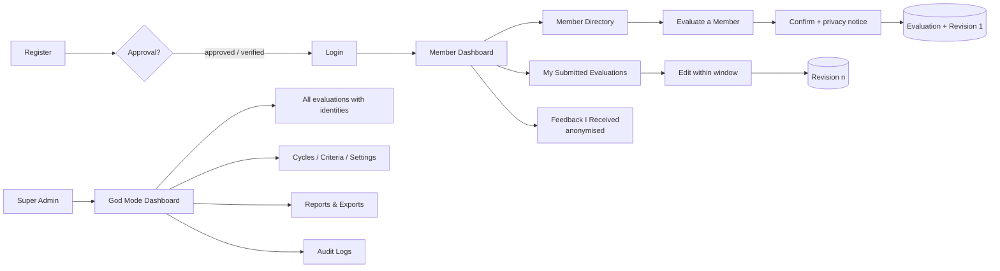

# System Overview

## Purpose
Give a choir a **private, organised and constructive** way for members to evaluate one
another, share comments and suggestions, and review the feedback they receive, while
**protecting evaluator identities from ordinary users**.

## What it is
A web application (Django REST API + React SPA, one deployable **modular monolith**,
see [[Architecture Overview]]) for one choir group.

- Every registered, active member can **evaluate other members** using
  administrator-configured **rating criteria**, **written comments** and **suggestions**.
- A member can view the **feedback they received** and the **number of evaluations
  received**, but **never the names** of the members who wrote it.
- A member can view and **edit their own submitted evaluations** within the allowed
  window. Every edit is kept as an **immutable revision**.
- The **Super Admin ("God Mode")** has full access: evaluator identities, member
  management, rating configuration, cycles, moderation, reports, exports, audit logs and
  system settings. All of it is audit-logged.

> [!warning] Privacy rule shown to users
> Evaluator names are **hidden from evaluated members and ordinary users**, but are
> **visible to the Super Admin**. The UI must explain this clearly **before** a user submits an
> evaluation. See [[Privacy Model]].

## Core flows

## Modules
[[Core]] · [[Accounts]] · [[Members]] · [[Evaluations]] · [[Feedback]] ·
[[Notifications]] · [[Reports]] · [[Audit]] · [[System Settings]]

## Related
- [[Roles and Permissions]]
- [[Functional Requirements]]
- [[Source Requirements]]
