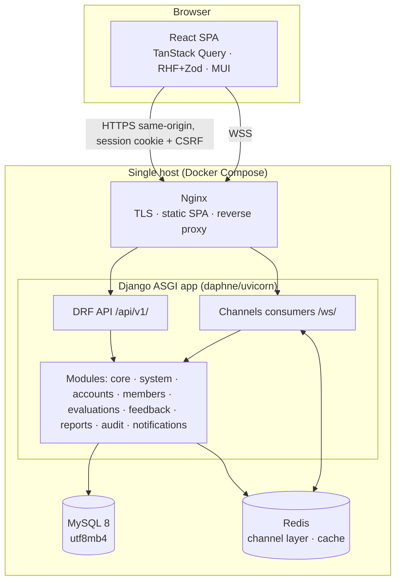
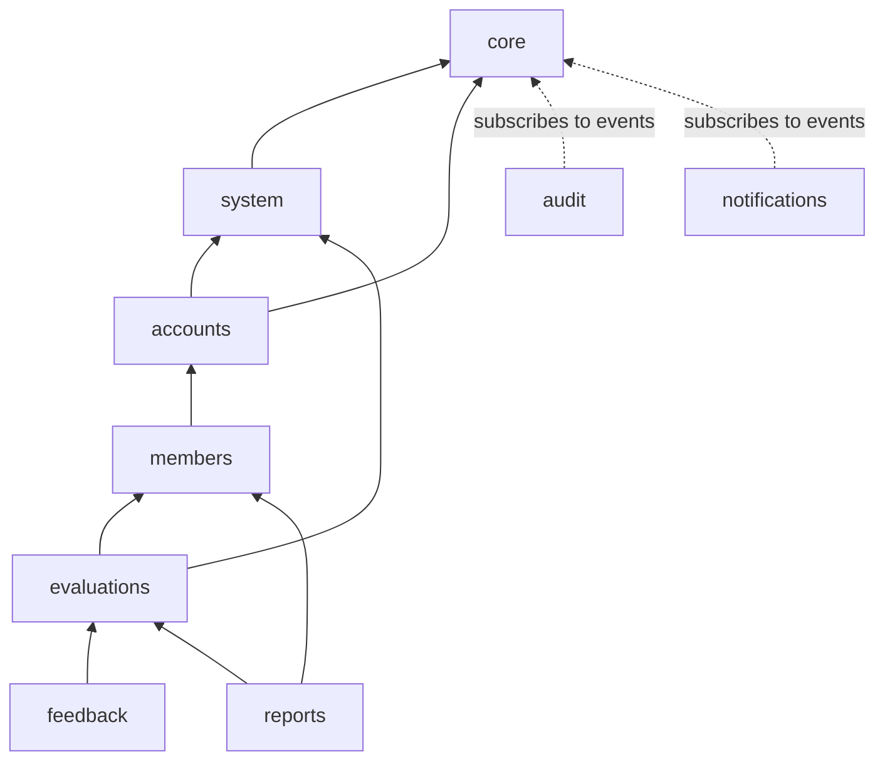

# Architecture Overview

## Style: modular monolith
- **One backend deployable**: a Django 5.2 project served over **ASGI** (HTTP + WebSockets).
- **One frontend**: a React + Vite + TypeScript SPA, built to static files.
- **Module by module inside**: each business capability is a Django app under
  `backend/apps/` with its own models, services, selectors, API and tests, and a matching
  feature folder under `frontend/src/features/`.
- Modules communicate through **public interfaces** (services/selectors) and
  **in-process domain events**, never by reaching into each other's internals.
  See [[Module Boundaries]].

**Why a modular monolith?** One choir means modest scale. One deployable keeps hosting,
transactions and debugging simple. Strict module boundaries keep the code maintainable,
and any module could be extracted later if needed. See ADR-001 in [[Decisions Log]].

## Runtime view

In development, the **Vite dev server proxies** `/api` and `/ws` to Django on `:8000`, so
the browser sees a single origin. No CORS is needed in dev or prod.

## Module dependency graph

Arrows point from a module to what it may depend on. `audit` and `notifications` are
**event consumers**: other modules never import them (one exception: see [[Module Boundaries]]).

## Request lifecycle (backend)
1. URL → module `api/urls.py` → view (thin).
2. View: `permission_classes` → serializer validates input.
3. View calls a **service** (write) or **selector** (read).
4. Service enforces business rules, writes in `transaction.atomic()`, publishes
   **domain events** (dispatched on commit).
5. `audit.handlers` / `notifications.handlers` react to events.
6. View serializes the result with a **role-appropriate serializer** (member vs admin).

## Key cross-cutting designs
- [[Privacy Model]]: anonymity guarantees and how they are enforced
- [[Security Model]]: auth, CSRF, throttling, secrets, append-only tables
- [[Realtime Architecture]]: Channels, groups, reconnects
- [[Data Model]]: entities and versioning
- [[API Conventions]]: URLs, envelopes, errors, pagination

Related: [[Backend Structure]] · [[Frontend Structure]] · [[Tech Stack]]
