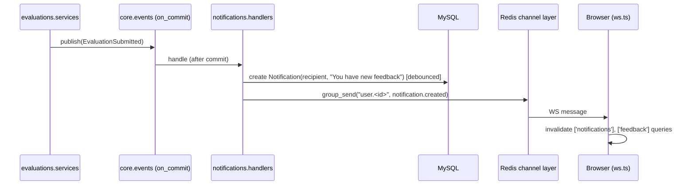

# Realtime Architecture (Phase 5)

## Components
- **Django Channels** on the ASGI app, with `channels-redis` as the channel layer.
- `config/asgi.py`: `ProtocolTypeRouter({"http": django_asgi_app, "websocket": AllowedHostsOriginValidator(AuthMiddlewareStack(URLRouter(websocket_urlpatterns)))})`
- Consumers live in `apps/notifications/consumers.py`.

## Channels & groups
| WS path | Who | Groups joined | Messages |
|---|---|---|---|
| `/ws/notifications/` | any ACTIVE member | `user.<user_public_id>` | `notification.created`, `feedback.available`, `cycle.status_changed`, `unread_count` |
| `/ws/admin/` | SUPER_ADMIN only | `admins` | `dashboard.counts`, `admin.activity`, `registration.pending` |

Message envelope: `{"type": "notification.created", "payload": {...}, "sent_at": "<iso>"}`.
Payloads are **safe**: generic text, links, counts. Never evaluator details (RT-06).

## Flow

## Client resilience (RT-05, NFR-04)
- `lib/ws.ts`: auto-reconnect with exponential backoff (1s → 30s max, with jitter).
- While disconnected, **poll** `GET /api/v1/notifications/unread-count/` every 30s.
- On reconnect, invalidate the notification, feedback and dashboard queries to resync.
- WS is an optimisation only. Every piece of state is also available over REST.

## Admin live dashboard
`reports` publishes recalculated counts to group `admins` (throttled to at most 1 per 5s)
when evaluations or registrations change.

Related: [[Notifications]] · [[Architecture Overview]]
