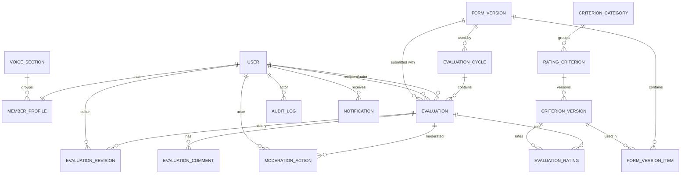

# Data Model

MySQL 8, `utf8mb4_unicode_ci`, InnoDB. Every table has `created_at` / `updated_at` unless it
is append-only (then only `created_at`). Exposed entities have a `public_id` UUID. Integer
PKs are never used in URLs.

## ERD


## Tables

### accounts
**User**: `id`, `public_id`, `email` (U), `username` (U), `password`, `first_name`,
`last_name`, `display_name`, `role` (MEMBER|SUPER_ADMIN, idx), `status` (`is_active` is a property derived from it)
(PENDING|ACTIVE|SUSPENDED|DEACTIVATED, idx), `email_verified_at`, `approved_by_id`,
`approved_at`, `is_staff`, `is_superuser`, `last_login`, `date_joined`, `updated_at`

### members
**VoiceSection**: `id`, `name` (U), `sort_order`, `is_active`
**MemberProfile**: `user_id` (PK, FK), `voice_section_id` (FK, idx), `joined_choir_on`,
`bio`, `photo`, `is_evaluable`, timestamps

### evaluations
**CriterionCategory**: `id`, `name` (U), `sort_order`, `is_archived`
**RatingCriterion**: `id`, `public_id`, `key` (U), `category_id`, `sort_order`,
`is_active`, `is_archived`, `current_version_id`, timestamps
**CriterionVersion** *(immutable)*: `id`, `criterion_id`, `version` (U with criterion),
`name`, `description`, `scale_type` (NUMERIC|PERCENT), `min_value`, `max_value`, `step`
(DECIMAL(6,2)), `labels` (JSON), `is_required`, `created_by_id`, `created_at`
**FormVersion**: `id`, `public_id`, `version` (U), `title`, `comment_required`,
`suggestion_required`, `comment_max_length` (default 2000), `suggestion_max_length`
(default 2000), `status` (DRAFT|PUBLISHED), `published_at`, `created_by_id`, timestamps
**FormVersionItem** *(immutable after publish)*: `form_version_id`, `criterion_version_id`,
`order`. Unique (form_version, criterion_version).
**EvaluationCycle**: `id`, `public_id`, `name`, `description`, `starts_at`, `ends_at`,
`edit_deadline`, `status` (DRAFT|OPEN|CLOSED|ARCHIVED, idx), `form_version_id`,
`allow_resubmission`, `evaluation_scope` (ALL|SAME_SECTION), `feedback_visibility`
(IMMEDIATE|AFTER_CLOSE), `created_by_id`, timestamps
**Evaluation**: `id`, `public_id`, `cycle_id`, `evaluator_id`, `recipient_id`,
`form_version_id`, `submission_number` (default 1), `status` (SUBMITTED|WITHDRAWN),
`current_revision_number`, `is_edited`, `moderation_status` (VISIBLE|FLAGGED|HIDDEN),
`submitted_at`, `last_edited_at`, timestamps
- `CheckConstraint(evaluator_id != recipient_id)` (BR-01)
- `UniqueConstraint(cycle, evaluator, recipient, submission_number)` (BR-12)
- Indexes: `(recipient_id, cycle_id)`, `(evaluator_id, cycle_id)`, `(cycle_id, submitted_at)`

**EvaluationRating**: `id`, `evaluation_id`, `criterion_version_id`, `value`
(DECIMAL(6,2), nullable = not rated), `label`. Unique (evaluation, criterion_version).
**EvaluationComment**: `id`, `evaluation_id`, `kind` (COMMENT|SUGGESTION), `body` (TEXT),
`moderation_status`. Unique (evaluation, kind).
**EvaluationRevision** *(append-only)*: `id`, `evaluation_id`, `revision_number`
(U with evaluation), `snapshot` (JSON: ratings by criterion_version, comment, suggestion),
`editor_id`, `change_summary`, `created_at`
**ModerationAction** *(append-only)*: `id`, `evaluation_id`, `comment_id` (nullable),
`action` (FLAG|HIDE|RESTORE), `reason`, `actor_id`, `created_at`

### audit
**AuditLog** *(append-only)*: `id`, `occurred_at` (idx), `actor_id`, `actor_role`,
`event_type` (idx), `target_type` + `target_id` (idx), `before`, `after`, `metadata` (JSON),
`ip_address`, `user_agent`, `request_id`. Indexes: (target_type, target_id), (actor, -occurred_at)

### notifications
**Notification**: `id`, `recipient_id`, `type`, `message`, `link`, `is_read`, `read_at`,
`created_at`. Index (recipient, is_read, created_at).

### system
**SystemSettings** (singleton pk=1, seeded by migration `system.0002`): see [[System Settings]]

## Versioning rules (CFG-06, BR-07, BR-18)
1. Editing a criterion's name, scale, labels or required flag creates a **new**
   `CriterionVersion`. Old versions are never modified.
2. A `FormVersion` collects specific criterion versions. Once `PUBLISHED`, its items
   are frozen.
3. A cycle points to one published `FormVersion`. Every `Evaluation` stores its
   `form_version_id` and each rating stores its `criterion_version_id`, so history
   always renders with the original scale.
4. Archiving hides a criterion from **new** forms only.

## Revision snapshot shape
```json
{ "ratings": [{"criterion_version_id": 12, "value": 4, "label": "Good"}],
  "comment": "…", "suggestion": "…",
  "form_version_id": 3 }
```

Related: [[Evaluations]] · [[Backend Structure]]
